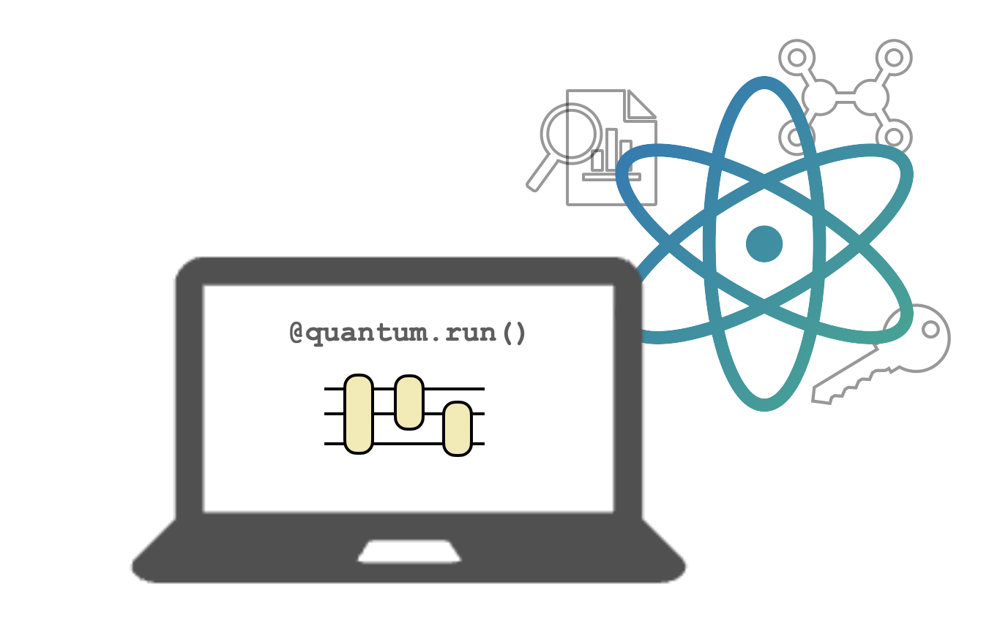

Repository for the "Quantum Algorithms and Software" course at Technische Universität Berlin (Wintersemester 2026/27)

Group: [Quantum Communication Networks](https://www.tu.berlin/qcn)

Professor: Dr. Anna Pappa

For the practical demos we will mostly use [Pennylane](https://pennylane.ai) and [Qrisp](https://qrisp.eu)

Requirements:

```bash
pip install -r requirements.txt
```

or 

```bash
pip install pennylane==0.45.0 qrisp==0.9.7
```